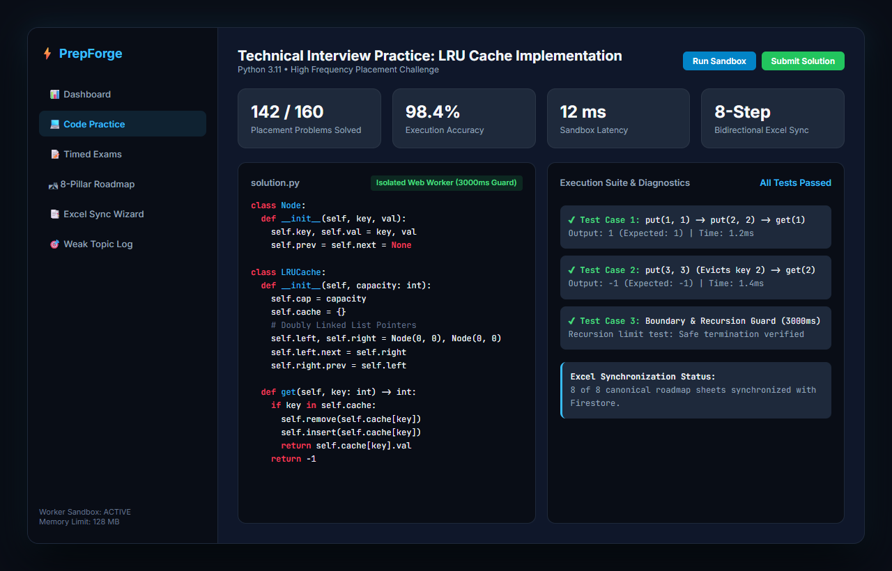

# PrepForge — Technical Placement & Code Practice SaaS Platform

> **Full-Stack Engineering Placement & Technical Interview Platform**  
> Complete technical interview preparation platform featuring an isolated Web Worker sandbox for Python coding challenges, an 8-step bidirectional Excel roadmap sync wizard, Firebase Cloud Firestore, timed exams, and learning analytics.

---

## 📸 Platform Dashboard & Sandbox Code Runner Preview

<p align="center">
  
</p>

---

## 🚀 Key Features

1. **Isolated Client-Side Python Web Worker Sandbox**:
   - Zero-cloud-cost instant execution inside an isolated Web Worker.
   - 3000ms recursion guard, memory limits, and zero network/DOM leakage.
   - Pluggable external cloud sandbox bridge (Judge0 / Piston / Cloud Functions).

2. **8-Sheet Bidirectional Excel Roadmap Integration**:
   - 8-step Dual-direction Import/Export Wizard.
   - Full support for `Dashboard`, `Master Roadmap`, `Daily Tracker`, `Python Practice`, `AIML Prep`, `Problem Log`, `Interview Q Bank`, and `Resources`.

3. **Production Placement Learning Matrix**:
   - 65+ hierarchical modules spanning Python (16), DSA (14), SQL/CS (9), AIML (17), and Placement Interviews (9).
   - Real-time timed exam engine with Fisher-Yates randomization and negative marking.

4. **Tech Stack**:
   - **Frontend**: React 18, TypeScript (Strict Mode), Vite, Tailwind CSS, Lucide Icons, Recharts
   - **Backend**: Firebase Authentication, Cloud Firestore, Cloud Storage, App Check, Cloud Functions

---

## 🛠 Local Setup & Running

```bash
cd prepforge
npm install
npm run dev
```

Run verification test suite:
```bash
npm run test
```

---

## 📄 License
Developed by **[Aryan Raikwar (aaryaninvincible)](https://github.com/aaryaninvincible)**. Distributed under the MIT License.
